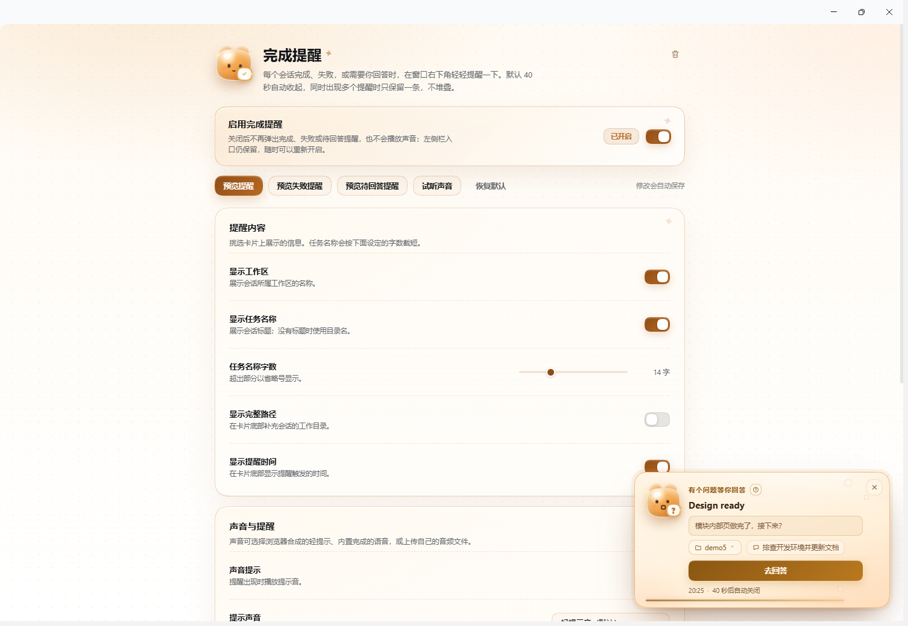
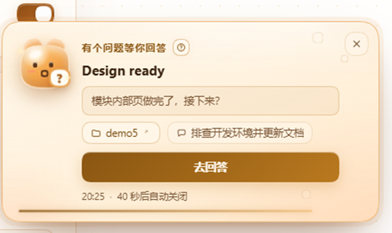
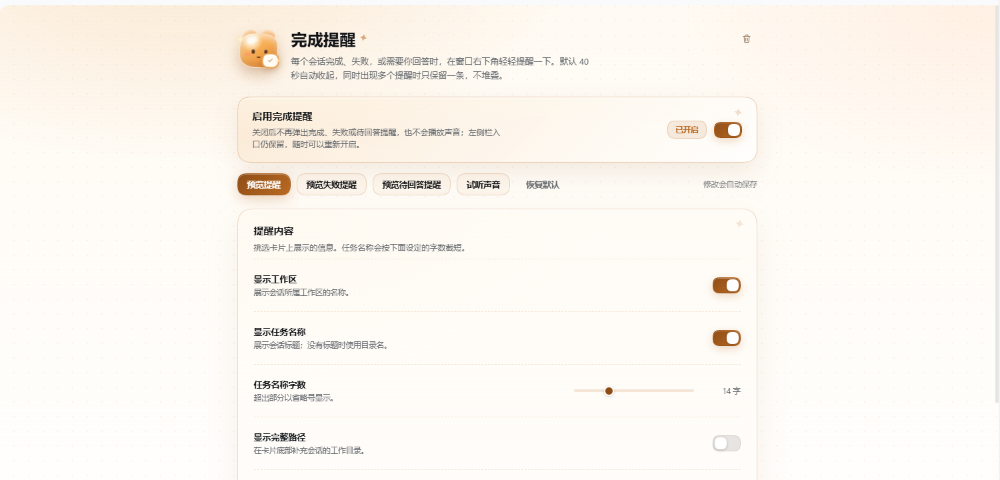

<div align="center">


<h1>完成提醒</h1>

<p><strong>让每一次等待，都有一个温柔的回应。</strong></p>

<p>DSH 会话完成、失败，或需要你回答时，在窗口右下角轻轻亮起一张暖色卡片。</p>

<p>
  
  
  
  
</p>



</div>

---

## 你需要的，不是又一个通知

跑长任务的时候，真正的焦虑往往不是“它慢”，而是：

- 你不知道它什么时候结束，只能反复切回来看看。
- 它失败了，却只留下一段难懂的报错，你还要自己猜原因。
- 它停下来问你问题、等你确认计划，而你在忙别的事，错过了。

**完成提醒**只做三件事：**完成时告诉你，失败时说清原因，需要你回答时把问题送到你眼前。** 不弹窗轰炸，不打断操作，不堆叠，不刷屏。

## 三种时刻，三种表情

### 完成：温柔收尾

会话从运行变为空闲时，右下角出现一张奶油色的卡片。吉祥物带着对勾，轻轻晃一下，然后安静地停留 40 秒。

### 失败：把原因说人话

额度不足、网络中断、登录失效、请求过频、上下文超限、服务不可用……插件会先归类，再保留原始错误摘要。失败卡片仍是暖色基调，只把点缀换成陶土红，不吓人，但足够醒目。

### 待回答：别让问题等你

当会话向你提问、请你确认计划，或等待授权操作时，卡片会显示具体问题或原因，并提供一个整行的「去回答」按钮。点一下，直接切到那个会话继续。

<div align="center">
  
</div>

## 适合谁

- 经常让 Agent 跑长任务，却不想一直盯着屏幕的人。
- 同时开多个会话，需要知道“哪一个先完成/失败了”的人。
- 会被 Agent 的提问卡住，但当时正在忙别的事的人。
- 用工具也想要一点美感，不想再看灰色系统通知的人。

## 和普通通知有什么不同

| | 普通系统通知 | 完成提醒 |
| --- | --- | --- |
| 位置 | 屏幕角落，和 DSH 割裂 | 默认窗口右下角；也可切换为 Windows 通知中心 |
| 失败信息 | 一句原始报错 | 先归类，再保留原始摘要 |
| 待回答 | 容易错过 | 问题直达，一键去回答 |
| 多个任务 | 容易堆叠 | 一次只来一条，不刷屏 |
| 视觉 | 冷冰冰 | DSH 内是暖色果冻团子；Windows 通知跟随系统样式 |
| 隐私 | 由系统通知服务统一展示 | 日常提醒不联网；检查更新时才访问 Gitee |

## 一眼看懂

| 能力 | 说明 |
| --- | --- |
| 完成提醒 | 会话跑完，右下角轻柔提示 |
| 失败诊断 | 识别额度、网络、登录、限流、上下文、服务端等原因 |
| 待回答提醒 | 提问、计划确认、授权请求都会提醒，并可一键跳转 |
| 不堆叠 | 同时只显示一条，下一条等上一条收起后再来 |
| 暖色设计 | 奶油磨砂、琥珀描边、蜜桃光晕，支持浅色/深色 |
| 眼睛跟随 | 吉祥物的眼睛会跟着鼠标方向轻轻转动 |
| 多种声音 | 轻提示音、清脆三音、柔和低音、木质轻敲、水滴声、叮咚、内置语音、自定义音频 |
| 工作区直达 | 点击卡片上的工作区，直接在系统文件管理器中打开 |
| 通知位置 | 默认自动选择；可切到 Windows 通知中心或桌面悬浮窗 |
| 自动选择 | 前台卡片；后台/最小化优先悬浮窗，否则 Windows；全屏只保留声音 |
| 就地配置 | 左侧栏「完成提醒」里集中配置，修改自动保存 |
| 在线更新 | 设置页检查 Gitee 版本并热更新运行文件，设置和自定义音频保留 |
| 一键卸载 | 设置页右上角垃圾桶图标，确认后走 DSH 插件管理器卸载 |
| 关于 | 标题「关于」；显示 DSH会话完成提醒、版本、AGPL-3.0 与 Gitee 入口 |
| 响应式 | Body Portal 固定到真正的窗口右下角，窄屏矮屏自动收紧 |
| 几乎零开销 | 不轮询、不写会话记录、没有常驻后台任务 |

## 界面

设置页与提醒卡片使用同一套暖色令牌，浅色和深色主题都能融进 DSH。

<div align="center">
  
</div>

右上角的垃圾桶图标就是卸载入口。点击后会先弹出确认框，不会误触。

## 为什么是暖色

冷色适合工具，暖色适合陪伴。

长任务结束时，你需要的不是一条“系统通知”，而是有人轻轻拍一下肩膀。奶油色、蜂蜜橙、桃子粉，配上会呼吸的果冻团子和一点星点闪光——它不抢你的注意力，但你很难忽略它。

## 轻到几乎感觉不到

- **不轮询。** 只读取 DSH 已有的会话状态投影和错误事件。
- **不写会话记录。** 设置与自定义音频只保存在当前浏览器。
- **没有常驻后台任务。** 没有卡片时，插件几乎不做事。
- **无构建步骤。** 没有打包器、外部 UI 依赖或 CDN；`client.js` 就是运行文件。
- **有节制的声音。** 只在你配置的提醒出现时播放，切歌会自动停掉上一条。

## 安装只要一分钟

1. 打开 DSH 左侧栏的 **插件**。
2. 点击 **添加插件**。
3. 粘贴 Git 地址：

   ```text
   https://gitee.com/user_gitee/dsh-completed-ding.git
   ```

4. 安装并启用，刷新一次页面。
5. 左侧栏出现 **完成提醒**，点进去就能配置。

也可以在“添加插件”里直接填本仓库的本地绝对路径，适合开发或离线安装。

> 需要 DSH 的 Web 或 Desktop 版本，并且带有插件管理器。插件没有构建步骤，安装后不需要额外安装依赖。
>
> 当前包版本：**1.5.4**（1.1.0 起支持检查更新与热更新；1.2.0 增加 Windows 通知中心与桌面悬浮窗；1.3.0 增加自动选择与全屏静音）。

### 更新

从 **1.1.0** 起，设置页底部有「版本与更新」：

1. 点击 **检查更新**，插件会通过 Host 向 Gitee 查询仓库中的 `package.json`。
2. 发现新版本后点击 **立即更新**，确认后下载并替换运行文件。
3. 完成后页面会自动刷新；如果提示需要重启 DSH，重启一次即可。
4. 设置、总开关和自定义音频都会保留。

检查更新和更新过程会访问 Gitee；日常提醒本身不联网。更早的版本没有这个按钮，需要先手动安装一次 1.1.0；Windows 通知中心与桌面悬浮窗需要 1.2.0，自动选择与全屏静音需要 1.3.0，每日自动更新需要 1.4.0。

### 自动更新

设置页「版本与更新」里可以选三种模式，默认 **不自动更新**：

- **不自动更新（默认）**：只在手动点击「检查更新」时查询 Gitee。
- **每天检查，发现新版本时提示我**：DSH 卡片会显示更新按钮，点击后直接更新；如果当时在后台，只发 Windows 通知提示，不给 Windows 通知加按钮。
- **每天检查，发现新版本时自动更新**：下载、校验并替换运行文件，完成后刷新页面；需要重启 DSH 时会显示提示。

启用后每天最多检查一次；检查会访问 Gitee，日常提醒本身不联网。

### 卸载

打开 **完成提醒** 设置页，点击右上角的垃圾桶图标，确认即可。也可以随时从左侧栏 **插件** 页面卸载。

## Windows 通知中心与悬浮窗

默认是 **自动选择**，也可以手动切换：

### 自动选择（默认）

- DSH 在前台时，使用 DSH 内卡片。
- DSH 切到后台、最小化或收回系统托盘时，优先使用已经打开的桌面悬浮窗。
- 悬浮窗没有打开、当前环境不支持，或已经关闭时，改用 Windows 通知中心。
- 选择自动后不需要手动切换，适合长期开着。

### DSH 内卡片

- 固定在 DSH 窗口右下角，使用果冻卡片、单卡片队列和自动关闭。
- 不会发出系统通知，DSH 不在前台时看不到。

### Windows 通知中心

- 提醒交给 Windows 通知中心显示，可以出现在 DSH 窗口之外，默认在桌面右下角。
- 首次切换时浏览器/系统会请求通知权限；未授权时会保留 DSH 内卡片。
- **不能像 DSH 内通知那样使用卡片样式**：没有果冻造型、进度条、按钮或自定义布局，只显示 Windows 允许的标题、正文和图标。
- 位置、圆角、停留时长、是否带系统声音都由操作系统决定，不能保证 20/40 秒自动消失。
- 点击通知会尝试聚焦 DSH，并打开对应会话。
- 默认 **其他应用全屏时不弹通知，只播放提示音**；可在设置里关闭这个行为。

### 桌面悬浮窗（实验）

- 使用 Document Picture-in-Picture 打开一个置顶小窗，可以一直浮在桌面右下角。
- 需要用户点一次 **打开悬浮窗**；窗口保持打开时，完成/失败/待回答会复用同一张卡片。
- 没有提醒时显示一张待机卡；关闭悬浮窗会自动回到 DSH 内卡片。
- 刷新页面或重启 DSH 后悬浮窗不会自动恢复，需要重新点开。
- 窗口位置、大小和标题栏由浏览器/系统控制，可以被用户拖动或关闭。
- 需要 Chromium 的 Document Picture-in-Picture；不支持时会提示并保留 DSH 内卡片。
- 当前 DSH Desktop（Electron 宿主）可能没有暴露这个 API；这不是插件报错，而是宿主能力限制。此时请用「Windows 通知中心」，或在 Chromium 浏览器里打开 DSH Web 再试。

这些方式不会和 DSH 内卡片同时显示，避免重复打扰。系统或 DSH 的 Electron 宿主不提供对应能力时，插件会自动回退到 DSH 内卡片。

## 常用配置

| 配置 | 默认 | 你能改什么 |
| --- | --- | --- |
| 总开关 | 开 | 临时关掉所有提醒与声音，入口保留 |
| 通知位置 | 自动选择 | 可切到 DSH 内卡片、Windows 通知中心或桌面悬浮窗 |
| 全屏时只保留声音 | 开 | 使用 Windows 通知中心时，其他应用全屏则不弹通知 |
| 自动更新 | 不自动 | 可改为每天提示或每天自动安装 |
| 自动关闭时长 | 40 秒 | 5–60 秒，想让卡片停久一点就拉长 |
| 待回答时提醒 | 开 | 只想要完成提醒时可以关掉 |
| 提示声音 | 轻提示音 | 六种短音可试听并应用；也可换内置语音或上传 MP3/WAV/OGG |
| 音量 | 55% | 只影响本插件 |
| 展示内容 | 工作区 + 任务名 + 时间 | 也可以打开完整路径 |
| 包含子代理 | 关 | 需要子代理也提醒时打开 |

完整配置、存储位置和常见问题见 **[使用手册](./docs/README.md)**。

## 关于隐私

插件在日常提醒中不发起任何网络请求，不上传会话内容，不读取凭据，不写入会话日志。只有你点击「检查更新」、确认更新，或每日自动更新检查到期时，Host 才会访问 Gitee 仓库；请求只读取公开的插件代码和版本信息。卸载按钮只是把操作交给 DSH 插件管理器，具体的包管理由宿主执行。

提醒所需的信息只来自 DSH 已经渲染在页面里的会话状态；设置和自定义音频保存在浏览器 `localStorage` 中，换浏览器或换设备不会同步。

## 常见问题

**会打断我正在做的事吗？**

不会。卡片是非模态的，不抢焦点；你可以继续操作，也可以点右上角关掉。

**为什么默认是 40 秒？**

足够你从别的事情里注意到它，又不至于长时间占着角落。可以随时调整。

**为什么有时候没有声音？**

浏览器要求先有一次用户交互才允许播放音频。点一下页面、再触发一次预览即可；也检查一下声音开关和音量。

**多个会话同时完成会叠在一起吗？**

不会。插件只保留一条当前卡片和一条待显示卡片，新的会替换旧的，不会堆成一面墙。

**卸载后我的设置还在吗？**

设置和自定义音频保存在浏览器里，卸载插件不会主动清理。需要彻底清除时，可以在浏览器开发者工具里删除对应的 localStorage 项。

## 文档

| 文档 | 内容 |
| --- | --- |
| [使用手册](./docs/README.md) | 安装、配置、更新记录、重要说明、故障排查 |
| [开发手册](./docs/develop-readme.md) | 架构、数据流、组件、样式、扩展与发布流程 |

## License

[AGPL-3.0](./LICENSE)

---

<div align="center">
  <sub>Built for DSH · 让等待有回应</sub>
</div>
