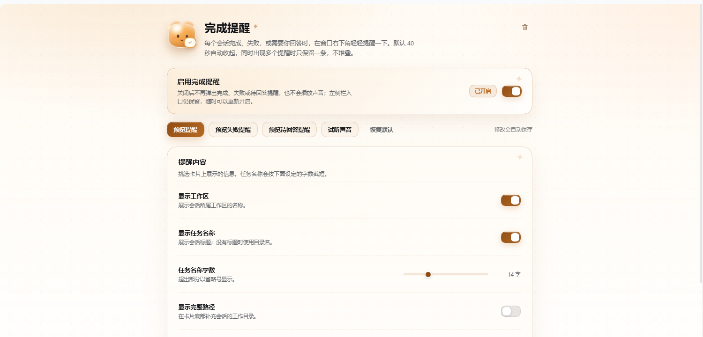
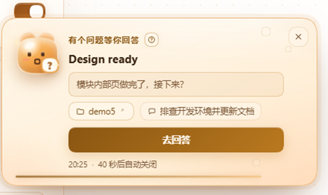

# 完成提醒 · 使用手册

> 面向安装者、配置者与日常使用者。<br>
> 项目宣传页：[项目主页](../README.md) ｜ 开发手册：[开发手册](./develop-readme.md)

**完成提醒**（`dsh-completed-ding`）是一个 DSH Web / Desktop 插件：会话完成、失败，或需要你回答时，在窗口右下角显示一张暖色提醒卡片。

---

## 目录

- [系统要求](#系统要求)
- [安装](#安装)
- [第一次使用](#第一次使用)
- [设置页说明](#设置页说明)
- [完整配置表](#完整配置表)
- [数据与存储](#数据与存储)
- [重要说明](#重要说明)
- [更新与卸载](#更新与卸载)
- [常见问题与故障排查](#常见问题与故障排查)
- [更新记录](#更新记录)
- [文件结构](#文件结构)
- [License](#license)

---

## 系统要求

| 项目 | 要求 |
| --- | --- |
| DSH | 带插件管理器的 Web 或 Desktop 版本 |
| 开发基线 | DSH `0.2.1-rc.5`（其他版本请先做回归测试） |
| 浏览器 | Chromium 内核；DSH Desktop 内置浏览器即可 |
| 构建 | 无需构建，无需 CDN，无需额外 npm 依赖 |
| 权限 | 只需要浏览器 `localStorage` 与页面内的声音播放权限 |

插件依赖 DSH 提供的几个页面座位和服务：

- `shell.overlay`：提醒卡片所在的全窗口浮层。
- `sidebar.panellist`：左侧栏「完成提醒」入口。
- `main`：设置页。
- 会话状态投影、`api-session/error` 事件、`session.openWorkspacePath`。
- `remote.pluginManager`：设置页右上角的卸载按钮（由 DSH 插件管理器提供，属于必需依赖）。
- 可选：`uiWorkspace.openSession`（跳转到待回答会话）、`pluginNavigation.openBundle`（打开插件详情页）。

`uiWorkspace` 或 `pluginNavigation` 缺失时，对应动作会退化为提示文字；`remote.pluginManager` 缺失时插件不会启用——本插件本身就是通过插件管理器安装的。

---

## 安装

### 方式一：从 Git 安装（推荐给普通用户）

1. 打开 DSH 左侧栏的 **插件**。
2. 点击 **添加插件**。
3. 在输入框中填入：

   ```text
   https://gitee.com/user_gitee/dsh-completed-ding.git
   ```

4. 点击 **安装**，等待插件管理器完成安装。
5. 如果出现 **立即启用**，点击它。
6. 刷新一次 DSH 页面。
7. 左侧栏出现 **完成提醒**，安装完成。

### 方式二：从本地目录安装

适合离线环境或修改过源码的情况。

1. 打开 **插件 → 添加插件**。
2. 填入本仓库的**绝对路径**，例如：

   ```text
   D:\Demo\demo6\dsh-completed-ding
   ```

3. 安装并启用，刷新页面。

开发时也可以让 profile 直接 `link` 到源码目录；这样修改 `client.js` 后刷新页面即可生效。具体做法见[开发手册](./develop-readme.md#本地开发安装)。

### 安装后检查

- 左侧栏有 **完成提醒** 入口。
- 打开设置页，顶部总开关为 **已开启**。
- 点击 **预览提醒**，右下角出现完成卡片。
- 点击 **预览待回答提醒**，右下角出现待回答卡片。

---

## 第一次使用

### 1. 打开设置页

点击左侧栏 **完成提醒**。

设置页从上到下分为：

- 英雄区与总开关。
- 预览与试听按钮。
- **提醒内容**：工作区、任务名、字数、路径、时间。
- **声音与提醒**：声音开关、声音来源、自定义音频、音量、自动关闭时长、连续提醒间隔。
- **提醒范围**：待回答时提醒、包含子代理会话。
- 顶部右上角：卸载图标。



修改会**自动保存**到当前浏览器，不需要点保存按钮。

### 2. 预览

| 按钮 | 效果 |
| --- | --- |
| 预览提醒 | 立即显示一条完成卡片 |
| 预览失败提醒 | 立即显示一条失败卡片 |
| 预览待回答提醒 | 立即显示一条待回答卡片 |
| 试听声音 | 按当前声音设置播放一次提示音 |
| 恢复默认 | 把设置恢复为默认值（自定义音频文件本身不会被删除） |

预览不依赖真实会话，适合第一次安装后确认样式、位置和声音。

### 3. 等待真实提醒

插件监听 DSH 已有的会话状态：

- **完成**：会话从运行变为空闲。
- **失败**：结束前收到 `api-session/error`，会把原因归类后显示。
- **待回答**：出现新的 `pendingInteraction`（提问、计划确认、授权请求）。

同一时间只显示一张卡片；如果连续来多个提醒，会等当前卡片收起后再显示下一条。

<div align="center">
  
</div>

---

## 设置页说明

### 总开关

关闭后：

- 不再弹出任何完成/失败/待回答提醒。
- 不再播放提示音。
- 左侧栏入口与设置页仍然保留，随时可以重新开启。

### 提醒内容

| 配置 | 默认 | 说明 |
| --- | --- | --- |
| 显示工作区 | 开 | 显示会话所属工作区名称 |
| 显示任务名称 | 开 | 显示会话标题；没有标题时使用目录名 |
| 任务名称字数 | 14 | 超出部分用省略号截断，可调 4–40 |
| 显示完整路径 | 关 | 在卡片底部补充工作目录 |
| 显示提醒时间 | 开 | 在卡片底部显示触发时间 |

### 声音与提醒

| 配置 | 默认 | 说明 |
| --- | --- | --- |
| 声音提示 | 开 | 提醒出现时是否播放提示音 |
| 提示声音 | 轻提示音 | 三种来源，见下表 |
| 自定义音频 | 空 | MP3 / WAV / OGG / M4A 等，最大 2 MB |
| 音量 | 55% | 0–100%，只影响本插件 |
| 自动关闭时长 | 40 秒 | 5–60 秒 |
| 连续提醒间隔 | 200 毫秒 | 上一条关闭后到显示下一条的间隔 |

**三种声音来源：**

| 来源 | 说明 |
| --- | --- |
| 轻提示音 | Web Audio 实时合成的三音柔和提示，不依赖外部文件 |
| 完成的语音.mp3 | 内置的「完成啦～」语音，更软甜 |
| 自定义音频文件 | 从本机选择音频，转成 Data URL 存在浏览器里 |

自定义音频的限制：

- 文件不超过 **2 MB**。
- 需要是浏览器能播放的音频格式（MP3、WAV、OGG、M4A、AAC、FLAC、WebM、Opus 等）。
- 解析失败或浏览器存储空间不足时，会在设置页给出提示。

### 提醒范围

| 配置 | 默认 | 说明 |
| --- | --- | --- |
| 待回答时提醒 | 开 | 会话提问、请求确认计划或授权时也弹窗 |
| 包含子代理会话 | 关 | 默认只提醒主会话；打开后子代理完成也会提醒 |

说明：

- “待回答”只对**当前浏览器能看到的**待回答交互生效。
- 同一个问题在页面刷新后会重新作为一次提醒出现；这是提醒，不是消息中心。
- 待回答卡片出现“去回答”按钮时，点击会切到对应会话；如果宿主没有 `uiWorkspace`，则退化成一行提示。

### 卸载图标

设置页右上角有一个垃圾桶图标：

1. 点击图标。
2. 在弹出的确认框中选择 **确认卸载**。
3. 插件会调用 DSH 插件管理器的卸载流程。
4. 如果当前进程不支持热卸载，会提示到左侧 **插件** 页面操作，或提示重启 DSH。

浏览器里的设置和自定义音频不会因为卸载而自动清除。

---

## 完整配置表

| 键 | 默认值 | 取值范围 | 说明 |
| --- | --- | --- | --- |
| `enabled` | `true` | 开/关 | 总开关 |
| `soundEnabled` | `true` | 开/关 | 声音开关 |
| `soundKind` | `chime` | `chime` / `voice` / `custom` | 声音来源 |
| `volume` | `0.55` | 0–1 | 音量 |
| `durationSeconds` | `40` | 5–60 | 自动关闭时长 |
| `gapMs` | `200` | 0–2000 | 连续提醒间隔 |
| `showWorkspace` | `true` | 开/关 | 显示工作区 |
| `showTask` | `true` | 开/关 | 显示任务名 |
| `titleChars` | `14` | 4–40 | 任务名字数 |
| `showPath` | `false` | 开/关 | 显示完整路径 |
| `showTime` | `true` | 开/关 | 显示提醒时间 |
| `includeSubagents` | `false` | 开/关 | 包含子代理 |
| `showWaiting` | `true` | 开/关 | 待回答时提醒 |

设置保存键：

```text
dsh-completed-ding.settings.v2
```

旧版设置键：

```text
dsh-completed-ding.settings.v1
```

升级到 v2 时，如果旧值仍是 20 秒（旧默认值），会一次性迁移为 40 秒；手动改过的其他值保持不变。

自定义音频保存键：

```text
dsh-completed-ding.sound.v1
```

---

## 数据与存储

| 数据 | 位置 | 是否上传 |
| --- | --- | --- |
| 插件设置 | 浏览器 `localStorage` | 否 |
| 自定义音频 | 浏览器 `localStorage`（Data URL） | 否 |
| 最近错误摘要 | 页面内存（最多 60 条） | 否 |
| 提醒队列 | 页面内存 | 否 |
| 会话内容 | 不读取、不写入 | 否 |

- 同一浏览器的多个标签页会通过 `storage` 事件同步设置。
- 不同浏览器、不同设备之间**不同步**。
- 插件在日常提醒中不发送网络请求，不接入统计，不写会话日志。
- 卸载按钮只是调用 DSH 插件管理器的 `removeBundle`；具体的 pnpm/包操作由宿主完成，可能涉及本机文件变化。
- 浏览器隐私模式、禁用存储或 `localStorage` 配额不足时，设置/自定义音频可能无法保存。

### 清除设置

1. 打开 DSH 页面开发者工具。
2. Application / Storage → Local Storage。
3. 删除：

   ```text
   dsh-completed-ding.settings.v2
   dsh-completed-ding.settings.v1
   dsh-completed-ding.sound.v1
   ```

或者点击设置页的 **恢复默认**；它会把设置恢复默认，但不会删除已保存的自定义音频文件。

---

## 重要说明

1. **提醒是页面内的浮层，不是操作系统通知。** DSH 窗口最小化时不会出现系统级通知、通知中心条目或声音之外的外部提醒。
2. **同一时间只显示一条。** 这是刻意设计，避免多个会话同时结束时铺满屏幕。
3. **默认 40 秒自动关闭。** 卡片消失不代表会话状态改变；待回答的问题仍然在会话里等你。
4. **待回答提醒依赖 DSH 的待回答状态。** 如果宿主没有暴露 `pendingInteraction`，或者当前浏览器没有加载到该会话，插件不会凭空知道有提问。
5. **失败原因来自错误文本归类。** 插件会尽量给出准确标题，但供应商的错误文案千变万化，未知错误会统一显示“任务未完成”并保留原始摘要。
6. **自定义音频存在浏览器里。** 换浏览器、换设备、清理浏览器数据后需要重新上传。
7. **卸载不会清理设置。** 这是为了方便重新安装后接着用；需要彻底清理时按上面的方式删除 localStorage。
8. **本地 `link` 安装适合开发，不适合分发。** 如果 profile 里用的是本地路径，移动仓库位置后需要重新安装。
9. **插件没有构建步骤。** `client.js` 就是运行文件；修改后刷新页面即可（本地 link 安装时）。
10. **DSH 大版本升级后请回归测试。** 插件依赖 `shell.overlay`、`main`、`sidebar.panellist` 等座位，宿主结构变化可能需要适配。

---

## 更新与卸载

### 更新

第三方插件通常采用“先卸载、再安装”的升级方式：

1. 记录当前设置（通常不需要，设置会保留在浏览器里）。
2. 在左侧 **插件** 页面卸载旧版，或在设置页右上角卸载。
3. 用新地址重新安装。
4. 如果插件管理器提示重启，重启 DSH。
5. 刷新页面。

如果使用本地 `link` 安装：

1. 把新代码放到原目录。
2. 刷新 DSH 页面即可；必要时在插件页重新启用。

### 卸载

两种方式：

- 设置页右上角垃圾桶图标 → 确认卸载。
- 左侧栏 **插件** → 找到 **完成提醒** → 卸载。

如果提示当前进程不能热卸载：

1. 在 **插件** 页再试一次。
2. 或者重启 DSH 后卸载。
3. 仍然失败时，检查是否有其他层覆盖或该 bundle 是否被更高层锁定。

---

## 常见问题与故障排查

### 没有弹出提醒

按顺序检查：

1. 设置页顶部总开关是否为 **已开启**。
2. 是否是待回答提醒，但 **待回答时提醒** 被关掉了。
3. 是否是子代理会话，而 **包含子代理会话** 没开。
4. 会话是否真的发生了 `running → idle`，或者是否真的出现了待回答状态。
5. 刷新页面，确认插件已加载、左侧栏入口存在。
6. 打开浏览器开发者工具 Console，看是否有插件报错。

### 弹窗不在右下角

1. 确认使用的是包含 Body Portal 修复的版本（v10.31-1 之后）。
2. 刷新页面。
3. 如果仍然异常，记录 DSH 版本、窗口大小、显示器缩放和是否多屏，提交 issue。
4. 旧版可能受宿主浮层祖先的 `transform` / `filter` 影响，升级即可。

### 没有声音

1. 浏览器要求先有一次用户交互才允许播放音频：先点一下页面，再点 **试听声音**。
2. 检查 **声音提示** 开关和音量。
3. 自定义音频时检查文件是否超过 2 MB、格式是否可播放。
4. 检查系统输出设备和浏览器标签页是否被静音。
5. 如果选择了自定义音频但文件已被清除，插件会回退到轻提示音。

### 自定义音频保存失败

- 文件超过 2 MB。
- 浏览器 `localStorage` 配额不足。
- 浏览器处于隐私模式或禁用了存储。
- 文件不是浏览器支持的音频格式。

### 设置没有保存

- 浏览器禁用了 `localStorage`。
- 隐私模式 / 无痕窗口关闭后清除。
- 存储空间已满（尤其是保存过较大的自定义音频）。

### 旧版本升级后时长还是 20 秒

- 只迁移“仍为旧默认值 20 秒”的设置。
- 如果你手动设过其他值，会保留原值。
- 如果显示仍为 20 秒，可能浏览器存的是更早的键值；在设置页手动拉到 40 秒即可。

### 卸载按钮没有反应 / 提示手动卸载

- 宿主可能没有提供 `remote.pluginManager`。
- 当前进程可能不支持热卸载（需要重启）。
- 点击提示里的 **打开插件管理**，或直接去左侧 **插件** 页面卸载。

---

## 更新记录

> 版本号来自 Git 提交说明（日期版本），`package.json` 中的 `1.0.0` 是包版本，不随每次提交变化。

| 版本 | 日期 | 主要变化 |
| --- | --- | --- |
| `10.31-7` | 2026-10-31 | 吉祥物眼睛跟随鼠标；尊重“减少动态效果” |
| `v10.31-6` | 2026-10-31 | 设置页右上角图标式卸载；待回答「去回答」改为整行大按钮 |
| `10.31-5` | 2026-10-31 | 新增待回答提醒：提问、计划确认、授权请求；问题详情、去回答跳转、预览与开关 |
| `v10.31-1` | 2026-10-31 | 暖色视觉重构；Body Portal 固定右下角；默认时长 40 秒；窄屏/矮屏适配；v1→v2 设置迁移 |
| `v10.30-4` | 2026-10-30 | 增加总开关；样式与内置语音调整 |
| `v10.30-3` | 2026-10-30 | 卡片视觉、图标与文案细节调整 |
| `v10.30-2` | 2026-10-30 | 失败原因识别、声音来源、工作区打开、队列等基础能力 |
| `v10.30-1` | 2026-10-30 | 首次提交 |

更细的提交记录：

```bash
git log --date=short --format='%h | %ad | %s'
```

> 2026-10-31：文档结构重构为根 README（宣传页）、`docs/README.md`（使用手册与更新记录）、`docs/develop-readme.md`（开发手册）；插件图标同步为暖色。运行时行为不变。

---

## 文件结构

```text
dsh-completed-ding/
├── README.md                 项目宣传页（面向用户）
├── docs/
│   ├── README.md             使用手册、更新记录、重要说明（本文件）
│   ├── develop-readme.md     开发手册
│   └── assets/               README 截图
├── client.js                 浏览器端全部实现：卡片、设置页、声音、队列、卸载
├── index.js                  Host 端占位（不注册后台资源）
├── cordis.patch.yml          Bundle 入口
├── locale/
│   ├── zh.json               插件管理器中的中文标题与描述
│   └── en.json               英文标题与描述
├── sounds/
│   └── 完成的语音.mp3         内置完成语音（运行时使用内嵌副本）
├── icon.svg                  插件图标
├── package.json              包信息与 DSH client 声明
└── LICENSE                   AGPL-3.0
```

---

## License

[AGPL-3.0](../LICENSE)
